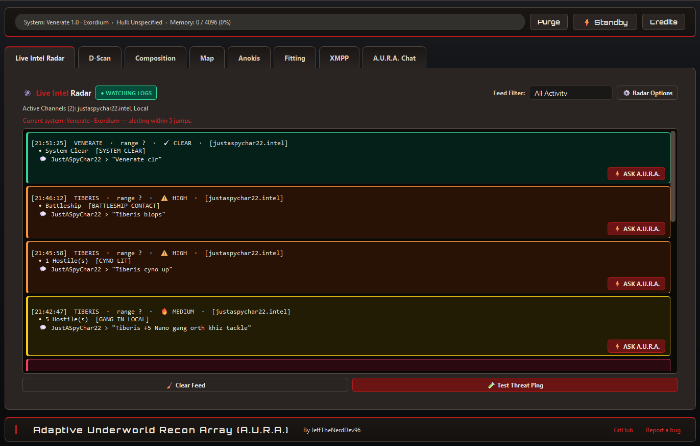
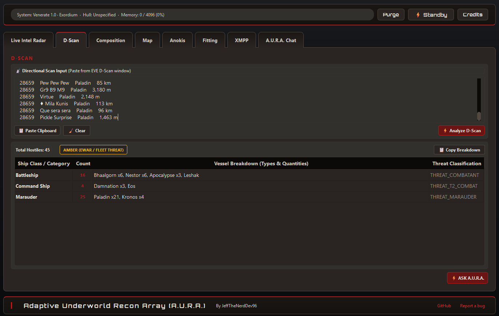
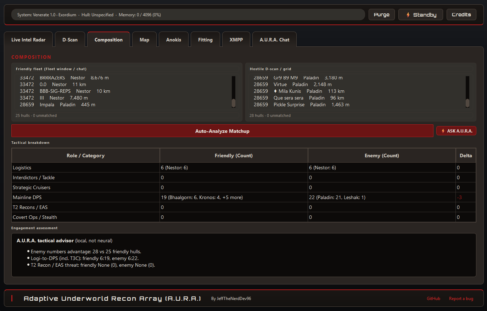
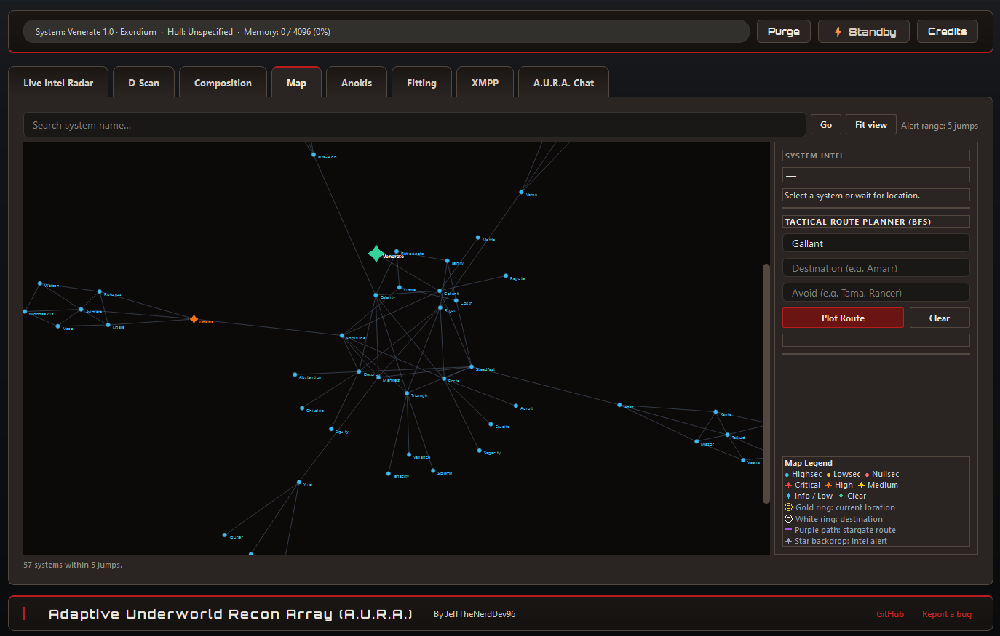
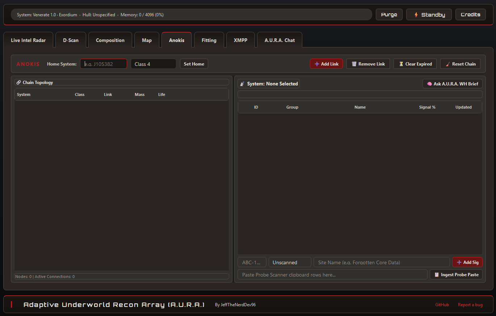
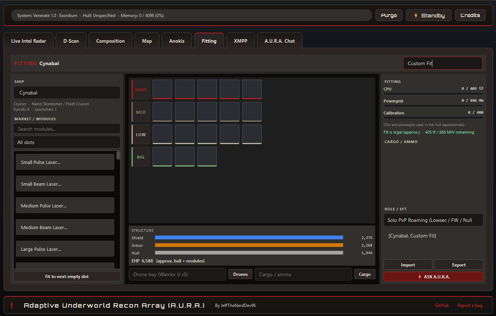
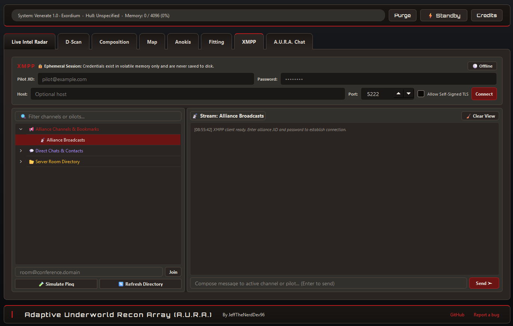
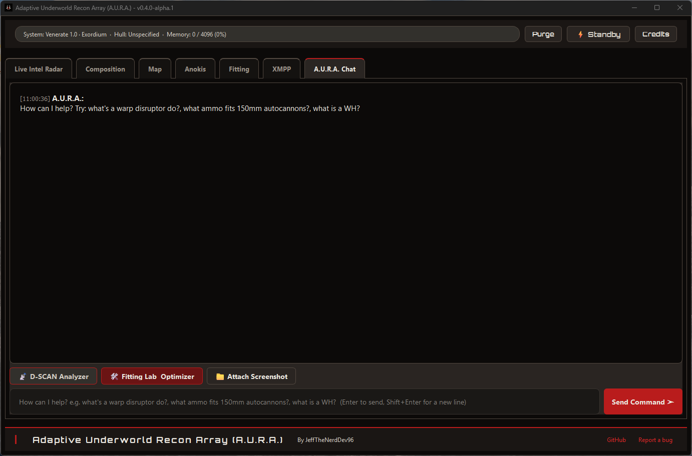

# Adaptive Underworld Recon Array (A.U.R.A.)

**v0.7.1-alpha.2** — unofficial New Eden tactical companion. Designed with a 100% No-ESI, offline-first architecture: A.U.R.A. operates with local neural reasoning, local log tailing, clipboard parsing, and offline SDE Dogma datasets, with optional opt-in network connectivity for Alliance XMPP communications and Mumble voice comms. No cloud telemetry. Zero ESI calls.

**EVE Online**, the **EVE logo**, and related marks are trademarks of **Fenris Creations** (FC Games / formerly CCP Games / CCP hf). All rights are reserved worldwide. All other trademarks are the property of their respective owners. EVE Online, the EVE logo, and all associated logos, designs, artwork, screenshots, character models, hulls, storylines, world lore, and game mechanics are the intellectual property of Fenris Creations.

A.U.R.A. is an unofficial, community-developed, fan-made tactical companion. It is **not** affiliated with, endorsed by, sponsored by, or operated in partnership with **Fenris Creations**, **FC Games**, or their affiliates.

---

Windows client support: Works with Steam Proton 11+ (verified on Ubuntu 24.04 and Fedora 43).

Linux edition: https://github.com/JeffTheNerdDev96/A.U.R.A.-eve-tool-linux (native Linux environments only).

---

## Tabs/Features

A.U.R.A. organizes its tactical suite into eleven specialized desktop tabs:

1. **Live Intel Radar** — Real-time chat log and game log tailer featuring heuristic threat classification (CLEAR to CRITICAL), hop-range proximity rings, and automated Windows alerts.
2. **Combat & Threat HUD** — Real-time combat telemetry tailing active gamelogs: 10s/30s/60s rolling incoming and outgoing DPS, 4-tier damage profiles (EM, Thermal, Kinetic, Explosive), active hostile tackle & EWAR tracking, live event stream, and one-click neural handover.
3. **D-Scan** — Dedicated Directional Scan analyzer with automatic ship class grouping, itemized vessel quantities (`Class : Count : Specific Ships xQty`), snapshot diffing (`DScanSnapshotDiff`), and on-demand "Ask A.U.R.A." tactical handovers.
4. **Composition** — Friendly fleet composition vs. hostile fleet analyzer. Includes multi-role breakdowns (Logistics, Interdictors/Tackle, Strategic Cruisers, Mainline DPS, T2 Recons / EAS, Covert Ops) and local matchup heuristics.
5. **Map** — Interactive stargate bubble graph centered on your current solar system, complete with intel threat overlays, BFS route planning, and custom system avoidance.
6. **Anokis** — Wormhole chain mapping for Anoikis J-space: interactive topology hierarchies, system class badges (C1–C6, Thera, Pochven, K-space), mass/lifetime decay tracking, static exit resolution, environmental weather multipliers (Wolf-Rayet, Pulsar, Magnetar, etc.), and cosmic signature management via EVE probe scanner clipboard ingestion.
7. **Utilities** — Industrial & tactical multi-suite:
   - *Cargo & Loot Valuation*: Offline inventory appraisal ($m^3$, ISK value, hauler sizing).
   - *Reprocessing & Refining*: Ore refining yields and net profit/loss with station/citadel tax adjustments.
   - *Survey Scanner & Mining Ledger*: Rock depletion planner, laser cycle throughput ($m^3$/hr), and session mining ledger.
   - *Killmail Importer & EFT Exporter*: Kill report analysis and automated EFT fitting conversion.
   - *Planetary Industry (PI)*: P0–P4 commodity production trees and POCO customs export tax.
   - *Item & Market Index*: Offline SDE baseline prices and volumes.
8. **Fitting** — Fitting Lab and EFT import/export with visual slot layouts, Dogma mathematical engine (stacking penalties, capacitor stability, align time, drone bay DPS, pirate implants, combat boosters, and J-space weather), hardpoint limits, and single-module constraints.
9. **XMPP** — Alliance tactical messaging and broadcast ping receiver (`xmpp_chat`). Features real-time MUC broadcast channel monitoring, ping urgency classification (CTA, StratOp, Formup), roster DMs, server room directory, and one-click tactical handover to A.U.R.A. Chat.  
   * *Security Notice:* XMPP credentials exist strictly in volatile memory for the active session and are **never saved to disk or configuration files**.
10. **VOIP** — Built-in Mumble client for alliance voice comms (`voip_mumble`). Channel tree with double-click join, hold-to-talk push-to-talk, server-synced mute/deafen, microphone and speaker device selection with live level meters, 48 kHz Opus voice, channel text chat, and Ask A.U.R.A. channel-transcript briefings.  
   * *Security Notice:* Mumble credentials are ephemeral — volatile memory only, wiped on disconnect, **never saved to disk**. Self-signed community servers require an explicit per-session opt-in.
11. **A.U.R.A. Chat** *(EXPERIMENTAL)* — Local GGUF neural reasoning core powered by `llama.cpp`. Serves as an onboard tactical assistant for combat briefings, live telemetry snapshots, document parsing, and screenshot OCR. The installer bundles **Phi-4 Mini (4-bit Q4_K_M)** for local execution. A custom tactical fine-tune (`AURA-Eve-Tactical-Instruct-3.8B`) is planned and is **not** the runtime default.

User operations: [USER_GUIDE.md](USER_GUIDE.md). Code internals & architecture: [DEVELOPER.md](DEVELOPER.md). Security & privacy policy: [SECURITY.md](SECURITY.md). Legal terms & disclaimers: [LEGAL.md](LEGAL.md). Release notes: [CHANGELOG.md](CHANGELOG.md).

## Screenshots

Operations captions live in [USER_GUIDE.md](USER_GUIDE.md). Tab order matches the app:

<table>
<tr>
<td align="center"><b>Live Intel Radar</b><br></td>
<td align="center"><b>D-Scan</b><br></td>
</tr>
<tr>
<td align="center"><b>Composition</b><br></td>
<td align="center"><b>Map</b><br></td>
</tr>
<tr>
<td align="center"><b>Anokis</b><br></td>
<td align="center"><b>Fitting</b><br></td>
</tr>
<tr>
<td align="center"><b>XMPP</b><br></td>
<td align="center"><b>A.U.R.A. Chat</b><br></td>
</tr>
</table>

---

## Offline-First Architecture

A.U.R.A. is engineered so that it **can be used as an offline-only app**:
* **Local Neural Inference:** Large language models run entirely locally via CPU, NVIDIA CUDA, AMD Vulkan, or Intel NPU coprocessors. Zero prompts or chat histories are sent to remote APIs.
* **Offline SDE Database:** Solar systems, stargates, ship hulls, and dogma attributes are bundled locally in `eve_map.json` and `core/eve_data.py`.
* **Passive Local Log Tailing:** Intel feeds read standard client text logs directly from disk.
* **Opt-In External Connectivity:** Outbound network connections are strictly opt-in and restricted to user-configured Alliance XMPP servers and Mumble voice servers. If not configured, the app operates completely offline in closed local compute mode.

---

## Running A.U.R.A.

```bash
git clone https://github.com/JeffTheNerdDev96/A.U.R.A-eve-tool.git
cd A.U.R.A-eve-tool
```

1. `A.U.R.A. Source/bat scripts for install/install_auto.bat` (or a named hardware script in that folder).
2. `scripts/run.bat` (or `A.U.R.A. Source/scripts/run.bat`)

Standalone: `AURA_Setup_v0.7.1-alpha.2.exe` (multi-system installer with clean upstream provisioning).

Details on hardware profiles and co-processors: [requirements/README.md](A.U.R.A.%20Source/requirements/README.md).

VOIP voice requires the Opus codec DLL. If voice is unavailable, run `tools/fetch_voip_runtime.py` to provision `voip_runtime/opus.dll` (text-only mode is unaffected).

---

## Credits & Attributions

Full attributions: [CREDITS.md](CREDITS.md) and the **Credits** modal in the application.

Inspired by [RIFT](https://riftforeve.online), [PYFA](https://github.com/pyfa-org/Pyfa), and [dscan.info](https://dscan.info). Map data from [Fuzzwork](https://www.fuzzwork.co.uk). XMPP protocol specifications by the XMPP Standards Foundation (XSF). Mumble voice protocol support via [pymumble](https://github.com/azlux/pymumble), with the Opus codec from the [Xiph.Org Foundation](https://opus-codec.org/) (conda-forge `libopus` build). EVE Online is intellectual property of Fenris Creations / CCP Games.

---

## License

Adaptive Underworld Recon Array (A.U.R.A.) is free and open-source software distributed under the terms of the **[GNU Affero General Public License Version 3 (AGPL-3.0)](LICENSE.txt)**.


---

## AI-Assisted Development & Quality Assurance (V0.7.1-alpha.1+)

**AI is intended to supplement, not replace, development and testing.**

A.U.R.A. has grown beyond its original scope into an all-in-one tool with 11 major features and approximately 60,000 lines of custom code. To manage this complexity as a solo developer, I use AI-assisted code reviews, edge-case testing, and validation alongside custom debugging scripts and automated test suites to identify potential bugs, regressions, and performance issues.

Starting with V0.7.1-alpha.1, releases will undergo additional AI-assisted reviews and audits. AI-generated findings are verified through code inspection, reproducible tests, and existing validation tools to help maintain reliability as the project continues to grow.

Agent-specific configuration and working files, including the `.agents/` directory where applicable, are excluded from version control through `.gitignore` to keep development tooling separate from the project's tracked source code.
